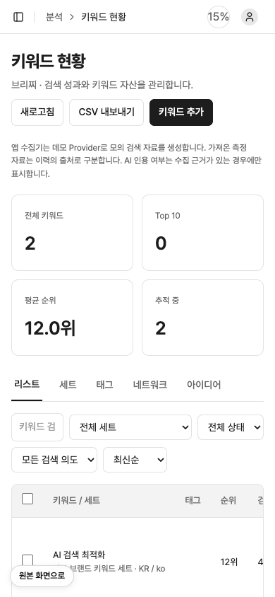
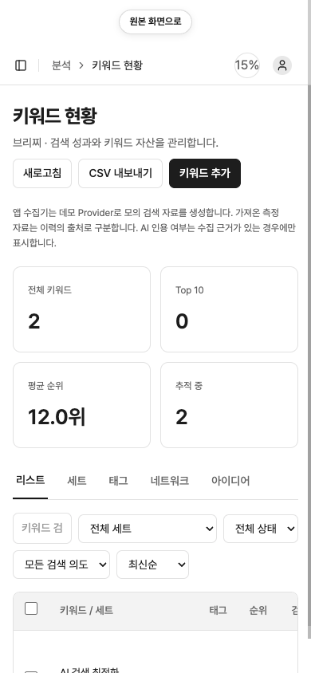

# QA Report: HaloX local application

| Field | Value |
|-------|-------|
| **Date** | 2026-10-26 |
| **URL** | http://127.0.0.1:3001 |
| **Branch** | main |
| **Commit** | 3a7d21a (2026-10-26) |
| **PR** | — |
| **Tier** | Standard + adversarial code review |
| **Scope** | 인증 후 앱 32개 라우트, 모바일 핵심 화면 5개, 최근 패리티/표시 모드 변경 |
| **Duration** | 약 30분 |
| **Pages visited** | 37 |
| **Screenshots** | 11 |
| **Framework** | Next.js 16.4.2 / React 19.2.0 |

## Health Score: 100/100

| Category | Before | After |
|----------|--------|-------|
| Console | 100 | 100 |
| Links | 100 | 100 |
| Visual | 92 | 100 |
| Functional | 100 | 100 |
| UX | 100 | 100 |
| Performance | 100 | 100 |
| Content | 100 | 100 |
| Accessibility | 100 | 100 |

가중 점수는 **99 → 100**입니다. 인증되지 않은 사용자가 보호 경로에 접근할 때 발생하는 `/api/v1/auth` 401은 로그인 화면으로 보내기 위한 명시적 보안 계약이며, 인증 후 32개 라우트에서는 JavaScript 콘솔 오류가 없었습니다.

## Top Things Fixed

1. **ISSUE-001: 모바일 표시 모드 버튼이 본문을 가림** — 390×844 화면에서 고정 버튼이 표와 설명문을 덮었습니다.
2. **CR-001: DOM 패리티 유사도에서 태그 개수 소실** — 태그명과 개수를 하나의 집합으로 평탄화해 서로 다른 DOM 분포를 잘못 비교했습니다.

## Console Health

| Result | Count | Scope |
|--------|-------|-------|
| 인증 후 JavaScript 콘솔 오류 | 0 | 앱 32개 라우트 |
| 깨진 이미지 | 0 | 앱 32개 라우트 + 모바일 5개 화면 |
| 문서 가로 넘침 | 0 | 앱 32개 라우트 + 모바일 5개 화면 |

## Summary

| Severity | Count |
|----------|-------|
| Critical | 0 |
| High | 0 |
| Medium | 2 |
| Low | 0 |
| **Total** | **2** |

## Issues

### ISSUE-001: 모바일 표시 모드 버튼이 본문을 가림

| Field | Value |
|-------|-------|
| **Severity** | medium |
| **Category** | visual |
| **URL** | http://127.0.0.1:3001/app/keywords |
| **Fix Status** | verified |

**Description:** 모바일에서 `.clone-mode-toggle`이 좌하단에 고정되어 현재 보이는 설명문과 테이블 행을 덮었습니다. 작은 화면에서는 버튼을 앱 본문 앞의 정상 문서 흐름에 배치해 어떤 본문과도 겹치지 않도록 수정했습니다.

**Repro Steps:**

1. 인증 후 `/app/keywords`를 390×844 뷰포트로 엽니다.
2. 좌하단의 `원본 화면으로` 버튼이 본문 위에 겹치는 것을 확인합니다.
   
3. 수정 후 버튼 하단(42.8px)과 앱 표면 상단(58.8px) 사이에 16px 간격이 있고, 교차 면적이 0인 것을 확인합니다.
   

### CR-001: DOM 패리티 유사도에서 태그 개수 소실

| Field | Value |
|-------|-------|
| **Severity** | medium |
| **Category** | verification tooling |
| **Scope** | `scripts/verify-parity.mjs` |
| **Fix Status** | verified |

**Description:** 기존 구현은 `Object.entries(profile).flat()` 결과를 집합 자카드로 비교했습니다. 따라서 `{ div: 100, span: 1 }`과 `{ div: 1, span: 100 }`처럼 태그 분포가 반대인 DOM도 동일 집합으로 취급될 수 있었습니다. 태그별 최소 개수 합을 최대 개수 합으로 나누는 가중 자카드로 교체했습니다.

**Evidence:** 실제 28개 라우트를 다시 계산했을 때 DOM 유사도가 최대 약 21.7%p 교정됐습니다. 새 단위 테스트는 위의 반대 분포를 `0.01`로 검증합니다. 최신 결과는 [패리티 매트릭스](../../docs/clone/parity-matrix.md)에 기록했습니다.

## Fixes Applied

| Issue | Fix Status | Commit | Files Changed |
|-------|-----------|--------|---------------|
| ISSUE-001 | verified | `6c6caea` | `src/components/ClonePage.tsx`, `src/components/clone-runtime.css`, `e2e/display-mode.spec.ts` |
| CR-001 | verified | `3a7d21a` | `scripts/verify-parity.mjs`, `scripts/parity-metrics.mjs`, `scripts/parity-metrics.test.mjs`, `package.json`, 패리티 결과 2개 |

## Regression Tests

| Issue | Test File | Status | Description |
|-------|-----------|--------|-------------|
| ISSUE-001 | `e2e/display-mode.spec.ts` | passed | 모바일 버튼과 앱 표면의 경계가 겹치지 않는지 실제 레이아웃 좌표로 검증 |
| CR-001 | `scripts/parity-metrics.test.mjs` | passed | DOM 태그 개수, 반대 분포, 동일/빈 분포 경계값 검증 |

## Verification Matrix

| Check | Result |
|-------|--------|
| TypeScript | passed |
| Next.js production build | passed |
| Unit tests | **373 passed** |
| End-to-end tests | **114 passed** |
| REA parity verification | **28 routes completed** |
| Ego authenticated route audit | **32 routes, 0 console errors, 0 broken images, 0 overflow** |
| Ego mobile audit | **5 screens, 0 broken images, 0 horizontal overflow** |
| Post-fix visual check | overlap `0px`, horizontal overflow `0px` |

## Ship Readiness

| Metric | Value |
|--------|-------|
| Health score | 99 → 100 (+1) |
| Issues found | 2 |
| Fixes applied | 2 (verified: 2, best-effort: 0, reverted: 0) |
| Deferred | 0 |

**PR Summary:** "QA found 2 medium issues, fixed and verified both; health score 99 → 100."

## Notes

- SOLAPI, SMTP, OpenAI, Google, NicePay 등 외부 자격 증명이 없는 상태는 UI와 E2E에서 정직한 미설정 상태로 검증했습니다.
- Ego Lite `0.6.0.16`에서 새 버전 알림이 있었지만, QA 실행 중 도구 업그레이드는 수행하지 않았습니다.
