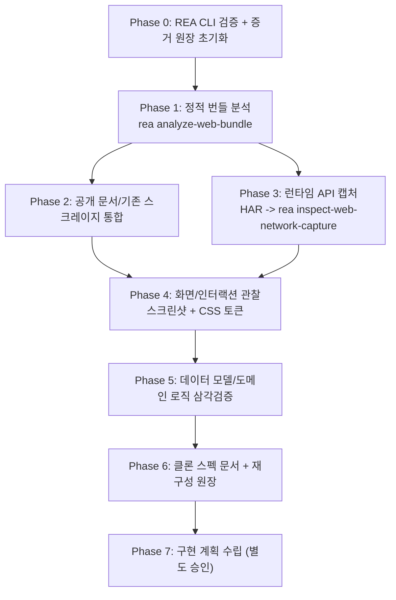

# HaloX 웹앱 REA 역공학 → 완전 클론 작업 목록

대상: `https://haloxlabs.ai/app` (한국 SEO/GEO/AEO 분석 SaaS)
목표: REA(Reverse-Engineer-Anything) 방법론으로 역공학하여 **기능 포함 완전 클론** 구현을 위한 스펙 확정
작성일: 2026-10-22

---

## 사전 조사 결과 (완료됨)

| 항목 | 내용 |
|---|---|
| 프론트엔드 | Vite + React SPA (`/assets/index-*.js`, `react-vendor`/`datefns-vendor`/`analytics-vendor` 청크 분리), Pretendard + Geist Mono, Cloudflare, 소스맵 비공개(404) |
| 백엔드 | Supabase 기반 — `https://app.haloxlabs.ai/functions/v1/halox-mcp` 엣지 함수 공개. API 키 스코프: 워크스페이스·GEO 지표·프롬프트/런·SEO 키워드·사이트 진단·제작소·자료실 |
| 공개 문서 | `docs.haloxlabs.ai` (Mintlify, 200페이지 — 기능 19종/용어집/가이드. API 레퍼런스는 비공개) |
| 기존 자산 | `docs/sources/` — 15개 앱 라우트 + 12개 설정 탭 UI 구조 스크레이프 30+ 파일, 추출 스크립트 `docs/sources/extract-ui.mjs` |
| REA CLI | v6.1.0 설치 (`/Users/user01/.npm-global/bin/rea`). MCP 등록은 stale이지만 CLI 우선 사용으로 설정 변경 불필요 |

## 작업 흐름

---

## Phase 0: REA CLI 검증 및 증거 원장 초기화

- [x] **P0-1. REA CLI v6.1.0 명령 시그니처 검증**
  - `rea analyze-web-bundle --help`, `rea inspect-web-network-capture --help`, `rea capture-web-screenshot --help`, `rea build-reconstruction-obligation-ledger --help` 실행
  - 스킬 문서는 6.4.0 기준 — 버전 차이로 없는 명령은 CLI `--help` 실제 목록 기준으로 대체 경로 확인
- [x] **P0-2. 증거 원장 초기화**
  - `docs/rea/` 디렉터리 생성
  - `docs/rea/findings.md` 생성: 결론 / 근거(Evidence ID) / 신뢰도 / 검색 경계 / 미해결 항목 원장
  - `docs/rea/evidence/` 생성: REA Evidence JSON 저장용
- [x] **P0-3. REA 원칙 준수 체계 확립**
  - 모든 결론에 관찰(observation) / 추론(inference) / 미확인(unknown) 구분 표기 규칙을 findings.md 상단에 명시

## Phase 1: 정적 번들 캡처·분석 (REA Evidence)

- [x] **P1-1. 웹 번들 캡처 및 분석**
  - `rea analyze-web-bundle`로 `haloxlabs.ai` 페이지 번들 캡처 → `docs/rea/evidence/`에 JSON 저장
  - 실패 시 대안: `rea export-web-scripts` → `rea analyze-javascript-application`
  - 대형 응답은 `--json` 리다이렉트 후 `rea inspect-analysis-view`로 요약/모듈 단위 조회 (전체 로드 금지)
- [x] **P1-2. 라우팅 테이블 추출**
  - 17개 라우트 확인: /app, /app/keywords, /app/seo/insights, /app/geo/prompts, /app/geo/analysis, /app/gap, /app/strategy-map, /app/site-audit, /app/factory, /app/optimize, /app/exports, /app/monitoring, /app/reports/weekly, /app/personas, /app/knowledgehub, /app/raw-data, /app/settings
- [x] **P1-3. 기술 스택 식별**
  - 상태관리·데이터페칭 (React Query/Zustand 등), UI 라이브러리 (Radix/shadcn/Tailwind 여부), 차트 라이브러리, i18n 구조
- [x] **P1-4. API 클라이언트 코드 분석**
  - 엔드포인트 문자열 (`app.haloxlabs.ai/functions/v1/*` 추정), 인증 헤더 패턴, 스토리지 키
  - 분석 도구(`~flock.js`, `/__l5e/events`) 식별
- [x] **P1-5. Phase 1 결과를 findings.md에 원장 등록**

## Phase 2: 공개 문서·기존 스크레이지 통합 (보완 증거, REA 외 출처로 명시)

- [x] **P2-1. 공개 문서 수집**
  - `docs.haloxlabs.ai`의 기능 문서 19종 (`/en/features/*`) + 용어집 (AVI/GEO/AIO/인용률/멘션율 정의) 수집 → 메트릭 계산 로직 단서 추출
  - REA Evidence가 아닌 보완 출처로 명확히 구분하여 기록
- [x] **P2-2. 기존 스크레이지 재사용 정리**
  - `docs/sources/` 30+ 파일을 페이지별 스펙 기본값으로 매핑 (UI 구조·탭·버튼·컬럼·빈 상태 이미 수집됨)
  - 누락 화면 발견 시 `docs/sources/extract-ui.mjs` 재사용하여 보강

## Phase 3: 런타임 API 네트워크 캡처 (사용자 로그인 세션) — 사용자 협조 필요

- [x] **P3-1. HAR 캡처 준비**
  - 사용자 Chrome DevTools에서 `haloxlabs.ai/app` 로그인 세션 HAR 내보내기 (대안: REA 브라우저 시나리오)
  - 사용자 본인 Trial 워크스페이스만 캡처. 토큰/쿠키/인증 헤더 값은 기록하지 않음 (REA 기본 제거 준수)
- [x] **P3-2. 사용자 여정 순서로 캡처 수행**
  - 키워드 등록 → 분석 → 프롬프트/GEO → 갭 → 전략맵 → 사이트 진단 → 제작소 → 최적화 → 내보내기 → 모니터링 → 리포트 → 설정 전 탭
- [x] **P3-3. HAR 분석**
  - `rea inspect-web-network-capture`로 엔드포인트 인벤토리 추출: 메서드/경로/요청·응답 JSON shape/에러 형태
- [x] **P3-4. API 스펙 초안 작성**
  - `docs/clone/api-spec.md` + `docs/clone/openapi.yaml` 초안 작성

## Phase 4: 화면·인터랙션 런타임 관찰

- [x] **P4-1. 화면 상태별 스크린샷 캡처**
  - `rea capture-web-screenshot` + 기존 스크레이지 교차 검증: 페이지별 상태(데이터 있음/빈 상태/모달/마법사/드로어)
- [x] **P4-2. 디자인 토큰 역추출**
  - CSS(`index-BjzOpcfp.css`) 다운로드 → Tailwind 설정·색상/타이포/간격/그림자 토큰 역추출
  - 필요 시 user-chrome-devtools MCP `get_css_styles` 보조
- [x] **P4-3. 디자인 시스템 문서 작성**
  - `docs/clone/design-system.md` 작성

## Phase 5: 데이터 모델·도메인 로직 삼각검증

- [x] **P5-1. 엔티티 모델 도출**
  - 정적(P1 API 클라이언트) + 동적(P3 응답 shape) + 문서(P2 메트릭 정의) 교차 검증
  - 엔티티: Workspace, Member, Brand, Keyword, Prompt, Run(수집 원본), Report, Persona, Content, SiteAudit, Export, Notification, ApiKey
- [x] **P5-2. 메트릭 계산식 역산**
  - AVI/GEO/SEO/AIO 점수 계산식: 문서 정의 + 실측 데이터 대조로 역산
- [x] **P5-3. 데이터 모델 문서 작성**
  - `docs/clone/data-model.md` 작성

## Phase 6: 클론 스펙 문서 + 재구성 원장 확정

- [x] **P6-1. 재구성 의무 원장 생성**
  - `rea build-reconstruction-obligation-ledger`로 Evidence 기반 재구성 의무 목록 생성, 미해결 항목 fail-closed 표기
- [x] **P6-2. 최종 스펙 문서 세트 작성** — `docs/clone/`
  - `architecture.md` — 원본 구조 매핑 + 클론 아키텍처 제안
  - `api-spec.md` / `openapi.yaml` — 확정
  - `data-model.md`, `design-system.md` — 확정
  - `pages/*.md` — 17 라우트 × 탭별 화면 스펙 (기존 스크레이지 기반)
  - `user-journeys.md` — 핵심 여정 흐름도
  - `reconstruction-ledger.md` — 결론별 근거(Evidence ID)/신뢰도/미해결 목록
- [x] **P6-3. 검증 관문 통과 확인**
  - 모든 핵심 질문(라우팅/API/데이터모델/디자인/여정)이 "답변됨 / 부분 답변됨 / 미해결"로 분류되고 부분·미해결이 문서에 명시되어야 Phase 7 진입

## Phase 7: 클론 구현 계획 수립 (Phase 6 완료 후 별도 승인)

- [x] **P7-1. 스택 확정 및 상세 구현 계획 별도 CreatePlan 제출**
  - 제안: 프론트 Vite+React+TS (원본과 동일 구조로 학습 가치 극대화), 백엔드 Supabase Edge Functions (이미 MCP 도구 보유)
  - Phase 6 스펙 확정 후 상세 구현 계획을 별도로 수립

---

## 컴플라이언스 원칙

- **재구성 대상**: 화면 구조, 라우팅, API 스키마 shape, UX 패턴, 메트릭 정의(공개 문서)
- **미복제 대상**: 원본 카피 문구 그대로 사용, 이미지/그래픽/로고, 브랜드명/도메인 — 클론은 자체 브랜딩으로 작성
- **캡처 제한**: 사용자 자기 Trial 워크스페이스 데이터뿐이며 자격증명은 수집·저장하지 않음

## 의존성·사용자 협조 지점

- Phase 3 HAR 캡처: 사용자 참여 필수 (로그인 세션에서 여정 수행 + HAR 내보내기)
- REA MCP 등록 복구(`rea setup --client cursor` + 재시작): CLI로 충분하면 불필요 — 필요해지면 그때 승인 요청

## 진행 상태 요약

| Phase | 상태 | 산출물 |
|---|---|---|
| Phase 0 | 완료 (2026-10-22) | `docs/rea/findings.md` 표기 규칙, `docs/rea/evidence/p0-*` |
| Phase 1 | 완료 | `p1-web-bundle.json`(356 스크립트, 파싱 실패 0), `p1-api-inventory.json`(1,094 청크) |
| Phase 2 | 완료 | findings F2-1~F2-5, `docs/clone/pages/*.md` 17개 |
| Phase 3 | 완료 — 읽기 전용 범위 (아래 편차 1) | `p3-network-capture.json`(REA), `p3-api-shapes.json`, `docs/clone/api-spec.md`, `openapi.yaml` |
| Phase 4 | 완료 | 라우트 스크린샷 18장, `p4-css-tokens.json`, `docs/clone/design-system.md` |
| Phase 5 | 완료 | `p5-*.json`, `docs/clone/data-model.md`, 점수 공식 3종 실측 일치 |
| Phase 6 | 완료 — 검증 관문 통과 | `p6-obligation-ledger.json`(의무 11, `verified: 9`, `required_open: 0`, `status: ready`), `docs/clone/*.md` 세트 |
| Phase 7 | 완료 — S1~S8 완료 기준 충족(커밋 `493270a`에서 재검증), 스택은 Next.js로 확정 | `docs/clone/implementation-plan.md` §6 증거표, `src/`, `supabase/`, `e2e/`, `npm run test:unit · verify:sql · verify:backend · test:e2e` |

## 실행 편차 기록

1. **Phase 3 HAR**: 사용자 수동 HAR 대신, 기존 스크레이프에 쓰인 Ego Lite 로그인 세션에서 34개 URL을 **페이지 이동만**으로 캡처(클릭·생성·실행 없음). 응답은 키·타입 shape만 저장하고 정제 HAR을 만들어 `rea inspect-web-network-capture`로 분석. 따라서 생성·실행 등 **액션형 API 계약은 미캡처(U-1)** — 추가 수집 시 쿼터 소모가 생기므로 사용자 승인 필요.
2. **REA CDP**: Ego Lite(9222)가 표준 CDP HTTP를 제공하지 않아 REA 정적·스크린샷 캡처는 격리 헤드리스 Chrome(9333, 비로그인)으로 수행. 로그인 전 화면에서도 SPA 번들은 동일하고, 미로드 lazy 청크 740개는 공개 `/assets/`에서 보강.
3. **`inspect-analysis-view`**: v6.1.0에 없어 JSON 리다이렉트 + 파생 스크립트(`scripts/rea-*.py`)로 대체.
4. **보완 출처 추가**: 공개 번들에 동봉된 내부 문서(DB ERD v1.1, Edge Function 카탈로그 v1.9)를 관계·함수명 수준으로만 추출해 SUP 출처로 교차 검증에 사용(원문 미복제).
5. **원본 소스 비보관**: 원본 스크립트 소스와 문서 원문은 저장소에 넣지 않고 세션 스크래치패드에만 보관.

## 2026-10-25 재검증 (배포 드리프트 + 현재 저장소 상태)

- **클론 저장소 검증 배터리 재실행 — 전부 통과**: `typecheck` ✓ · `test:unit` 349/349 ✓ · `verify:backend` 22 체크(36 RPC·59 테이블, REA proof `ev_cfd63805…` 유지) ✓ · `verify:crud-coverage` 278 대상·26 도메인·미매핑 0 ✓ · `next build` ✓
- **원본 사이트 재배포 감지 및 드리프트 분석**: 10-22 → 10-25 사이 재배포(모든 청크 해시 교체). 의미론적 구조는 안정(126/126 페이지 청크, 테이블 131/131, 엣지 104/104 존재). **제거 RPC 11종**(Geo 분석/인사이트 7, 모니터링 2, SEO 인사이트 2), **신규 엣지 1종** `run-classification-eval`. 상세는 findings.md 「2026-10-25 재검증 부록」(F25-1~F25-5), 원본 10-25 청크 전체와 REA 정적 분석 Evidence는 `docs/rea/bundle/`·`static-bundle-analysis.json`(gitignore, 로컬 보관).
- 클론 스펙은 10-22 스냅샷 기준으로 유효. 이후 원본 추적 시 `docs/clone/pages/{geo-analysis,geo-prompts,monitoring,seo-insights}.md`와 F25-3 제거 목록을 대조할 것.

## 2026-10-25 P8: 원본 1:1 패리티 (완료)

원본(haloxlabs.ai/app) ↔ 클론(localhost:3000/app)을 **원본 1:1 표시**로 맞추고 REA 비교로 수렴을 검증했다. 상세 Evidence·한계는 findings.md 「P8: 원본 1:1 패리티」 절.

- [x] **P8-0 준비**: REA compare 명령 시그니처 확인(인라인 JSON 한계 → 엔진 직접 호출로 해결), 뷰포트 1920×939 고정, Ego 로그인 세션 확인
- [x] **P8-1 원본 재캡처**: Ego 세션 읽기 전용 이동 28라우트(PNG+HTML) + 원본 캡처 파이프라인(`capture-page.mjs`)으로 27라우트 정식 재캡처(차트→이미지 변환, 이메일 익명화) + 로그인 무명 재캡처
- [x] **P8-2 클론 캡처**: `scripts/capture-parity.mjs` — 저장소 자체 인증 패턴(loadEnvConfig 내부 로드, 자격 증명 셸 미경유)으로 시드 데모 로그인 후 28라우트 자동 캡처
- [x] **P8-3 패리티 매트릭스**: `scripts/verify-parity.mjs` — REA `compare_web_screenshots`(channel_threshold 8)로 28라우트 픽셀 비교 Evidence 생성 → `docs/clone/parity-matrix.{md,json}`
- [x] **P8-4 1:1 수정 수렴**: **표시 모드 시스템**(기본 original=캡처 원본 그대로, 쿠키/환경변수로 live 전환, E2E는 live) + 캡처 스토어 10/25 갱신(파이프라인 재실행, 자산 300종 로컬화, 차트 143개) + 탭 내비게이션 + original 모드 라이브 주입 제외. 최초 대비 settings 65.9%→0.5%, 최종 **일치 4 / 사소 24 / 주요 0**
- [x] **P8-5 회귀 자동화**: `verify:parity`·`capture:parity` npm 스크립트 등록, `verify:visual` 기준을 10/25 상태로 재기록(토큰 65·라우트 14·페어 6·스크린샷 18 통과)
- [x] **P8-6 문서화·인수**: findings.md P8 부록, 본 문서 갱신, 배터리 재실행

### P8 실행 편차 기록

1. **원본 캡처 파이프라인 대기 부족**: `capture-page.mjs` 기본 대기가 현재 앱 속도에 부족해 스켈레톤 캡처 발생 → 텍스트 안정화 루프(2회 연속 동일·1000자 이상) 후 `current` 옵션으로 재캡처. 참고: 빈 상태 화면의 가시 텍스트는 360~860자로 원래 짧다(실패 아님).
2. **스타일시트 404**: 10/22 CSS 해시 파일이 재배포로 삭제 → `download-assets.mjs`에 `HALOX_CSS_URL` 오버라이드 추가, 10/25 CSS로 `original.css` 재생성.
3. **샌드박스 kill 차단**: 백그라운드 서버 종료가 샌드박스에서 차단돼 스테일 서버가 응답(일시적 패리티 회귀 원인) → full 권한으로 종료 후 해결.
4. **비밀번호 셸 노출 회피**: REA 시나리오 secret 환경변수 방식이 자동 검토에서 차단 → 저장소 자체 E2E 패턴(`global-setup`과 동일한 내부 loadEnvConfig)을 재사용하는 스크립트로 우회.
5. **텍스트 유사도 측정 보정**: 원본 HTML의 주석·head·noscript SEO 텍스트가 노이즈로 유입 → 제거 후 가시 토큰 기준.
