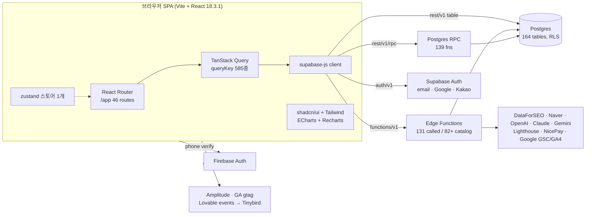

# 아키텍처 (원본 구조 매핑 + 클론 제안)

> 결론 먼저: 원본은 **Lovable로 생성된 Vite + React 18 SPA가 Supabase(PostgREST·RPC·Edge Functions·Auth)를 브라우저에서 직접 호출하는 BaaS 구조**다. 서버 비즈니스 로직은 Postgres RPC(집계)와 Deno Edge Functions(외부 API·LLM·크롤·배치)에 있다. 클론도 같은 구조가 학습·구현 비용 모두 가장 낮다.
>
> 비유: 원본은 "주방(DB)과 배달 기사(Edge Function)만 있고 홀 직원(API 서버)이 없는 식당"입니다. 손님(브라우저)이 주방 창구(PostgREST)에 직접 주문하고, 복잡한 요리만 배달 기사에게 맡깁니다.

## 1. 원본 구조 [관찰]



| 영역 | 관찰 내용 | 근거 |
|---|---|---|
| 빌드 | Vite(런타임 감지), 청크 1,094개 (진입 시 356개 로드), 벤더 청크 분리 react/datefns/analytics/export/firebase/dompurify, 소스맵 미배포 | E1-1 inferences, source_maps.items=0 |
| 출처 플랫폼 | `__l5e/events`가 `__lovableEvents` SDK, 번들 내 `lovable.dev`/`lovable-preview-auth` 문자열 | E1-2, 스크립트 원문 |
| 호스트 모드 | 하나의 번들이 호스트별로 분기: 앱 호스트면 `/app` 트리만, 마케팅 호스트면 `/`, `/admin/*`, 블로그·도구 등 전체 트리 | E1-1 라우트 트리 (`pS()==="workspace"`) |
| 라우팅 | React Router `<Routes>`; `/app` 레이아웃 → 인증 페이지 10종 + 보호 레이아웃 하위 36종; 미지정 경로는 `/app`으로 리다이렉트; `/app/usage`→`/app/settings?tab=plan`, `/app/geo`→`/app/geo/prompts`(앱 모드) | E1-1 |
| 데이터 페칭 | TanStack Query(전체 1,094 청크 기준 고유 `queryKey` 585종, `mutationFn` 사용 청크 94개), 무거운 RPC는 `rpc-cache` Edge 경유 후 실패 시 직접 RPC 폴백 | E1-4, E3-1 |
| 상태 | 서버 상태=Query 캐시, UI 상태=React state + localStorage(사이드바·뷰 접힘·모드), zustand 1곳 | E1-4 스토리지 키 |
| i18n | 자체 사전 함수 `h(key, lang)` (i18next 미사용), ko/en | 번들 문자열 |
| 인증 | Supabase Auth(이메일/비밀번호, Google·Kakao OAuth, 비밀번호 재설정, 이메일 찾기, 초대 토큰) + Firebase `signInWithPhoneNumber`(휴대폰 인증) | 번들 |
| 모드 | 워크스페이스별 **light/pro** 모드(`workspace-mode:{id}`, 기본 pro). light는 집계 RPC(`get_light_*`), pro는 세부 RPC(`get_pro_dashboard_kpi`, `get_avi_overview`) | E1-4, E3-1 |
| 쿼터 | 액션 전 `reserve_unit_with_bypass` → 성공 시 `commit_reservation`, 실패 시 `release_reservation` (멱등키) | data-model.md |
| 실시간 | `.channel()` 구독 없음; 진행 중 작업은 폴링(`useDiscoverRunProgress`, `live-pulse` 애니메이션) | E1-4 (channel 0건) |
| 관측 | `client_web_vitals` 테이블에 CWV 기록, `client_errors` 테이블, Amplitude, gtag | E3-1 |

### 1.1 앱 셸 공통 호출 [관찰 · 모든 라우트 34/34에서 반복]

로그인 기록(`rpc/record_auth_login`), 계정 삭제 예약 취소 확인(`rpc/cancel_account_deletion`), 플랫폼 관리자 확인(`platform_admins`), 플랜/구독/주문(`workspace_plans`, `subscriptions`, `orders`, `plan_templates`, `workspace_billing_overrides`), 쿼터(`rpc/get_workspace_quota_summary`, `rpc/get_billing_period_range`, `workspace_usage`), 멤버(`workspace_members`), 일시정지 요약(`rpc/get_paused_summary`), 활동 스냅샷(`rpc/get_user_activity_snapshot`, `rpc/get_workspace_activity_snapshot`), 퍼널(`rpc/get_full_funnel_stats`), 웰컴 가이드(`welcome_guide_config/settings`), 진단 상태(`site_audit_scans`), 프롬프트 세트(`geo_prompt_sets`).

→ 클론은 이를 **단일 `get_app_shell(workspace_id)` RPC**로 통합해 왕복 수를 줄인다 [추론·제안].

### 1.2 비동기 파이프라인 [관찰-정적 + SUP 카탈로그]

| 파이프라인 | 트리거(클라이언트) | 서버 단계 | 상태 저장 |
|---|---|---|---|
| 온보딩 | `user-create-workspace` → `analyze-domain-for-onboarding` → `generate-onboarding-prompts` / `onboarding-keyword-analysis` → `trigger-onboarding-async` | 키워드·프롬프트 자동 생성, 사이트 진단 시작 | `onboarding_jobs`(phase, expected/completed_count) |
| 키워드 수집 | `bulk-collect-keyword-data`, `dataforseo-*`, `naver-*`, `fetch-serp-snapshot` | 검색량·KD·의도·SERP·AIO | `keywords.*_updated_at`, `serp_snapshots`, `keyword_serp_jobs` |
| GEO 실행 | `geo-run-prompts-fanout` | 엔진별 실행(OpenAI/Claude/Gemini 등) → 멘션·인용 파싱 → 지표 | `geo_prompt_runs` → `geo_answers_raw`, `geo_citations`, `geo_run_metrics`, `geo_fan_out_queries` |
| 질문 발굴 | `geo-discover-run` | PAA/키워드 기반 후보 생성·분류 | `geo_discover_runs`, `geo_prompt_candidates` |
| 사이트 진단 | `site-audit-start` → `site-audit-worker` → `site-audit-finish-crawl` (+ recheck/reanalyze/diagnose-page) | 크롤 + Lighthouse 콜백 + 점수 | `site_audit_scans/pages/issues/links` |
| 전략맵 | `strategy-map-orchestrator` → `strategy-map-cluster` → `strategy-map-link-prompts` → `update-cluster-geo` | 클러스터링·프롬프트 연결 | `keyword_clusters`, `keyword_prompt_links`, `workspaces.strategy_map_status` |
| 콘텐츠 제작 | `analyze-keyword-strategy` → `generate-content-draft`(+이미지/다이어그램, grounding) | 전략→초안→품질 점수 | `content_jobs.stage/strategy_status/writing_status`, `content_drafts` |
| 콘텐츠 최적화 | `citability-fetch-url` → `citability-improve` (카탈로그상 optimize-* 4단계) | 진단→SERP→전략→재작성 | `content_review_runs` |
| 리포트 | `generate-weekly-snapshot`, `generate-report-summary` | KPI 스냅샷 + 요약 | `report_snapshots` |
| 결제 | `nicepay-*` | 주문·승인·정기결제·취소 | `orders`, `subscriptions` |

서버 내부 단계 순서·재시도·cron 주기는 [미확인] (unavailable authority: 서버 소스).

## 2. 클론 아키텍처 제안 [추론 · Phase 7에서 별도 승인 필요]

```mermaid
flowchart LR
    subgraph FE["apps/web — Vite + React + TS"]
      RT[React Router] --> TQ[TanStack Query]
      TQ --> API[lib/api: zod 검증 래퍼]
    end
    API --> SPG[(Supabase Postgres\n핵심 19 테이블 + RLS)]
    API --> SRPC[RPC: app_shell, dashboard_kpi,\nkeyword_overview, geo_overview]
    API --> SEF[Edge Functions\nkeywords-collect, geo-run, site-audit,\ncontent-draft, report-snapshot]
    SEF --> PROV[Provider 어댑터\n(SERP·LLM·Lighthouse) — 목업 우선]
```

| 결정 | 제안 | 이유 |
|---|---|---|
| 프론트 | Vite + React 18 + TS + Tailwind + shadcn/ui + TanStack Query + React Router | 원본과 동일 → 스펙 1:1 대응 |
| 백엔드 | Supabase (Postgres + RLS + RPC + Edge Functions) | 원본 계약(`api-spec.md`)을 그대로 재현 가능 |
| 외부 의존 | Provider 인터페이스 뒤에 숨기고 1차 구현은 결정적 목업 | DataForSEO·LLM 비용/키 없이 E2E 테스트 가능 |
| 점수 계산 | `packages/metrics` 순수 함수 (GEO/SEO/AVI 종합) + 단위 테스트 | 역산 공식 검증 대상(아래 §3) |
| 검증 | 경계 입력은 zod, 외부 응답도 zod 파싱 | 사용자 규칙(입력 검증) 준수 |

## 3. 점수 엔진 (역산 결과 요약 — 상세는 `reconstruction-ledger.md`)

| 점수 | 공식 | 상태 |
|---|---|---|
| GEO | 인용률×0.25 + 멘션율×0.25 + 인용 순위×0.25 + 멘션 순위×0.25, 0–100 반올림 | **확정** (번들 상수 + 실측 60 일치) |
| SEO | 순위점수×0.4 + Top10비율×0.3 + AIO인용률×0.3 | **확정** (번들 + 실측 3 일치). 공개 문서의 40/30/20+추세10은 불일치 |
| AVI 종합(대시보드) | SEO·GEO·웹 모두 있으면 0.4/0.3/0.3, GEO만 0.5/0.5/0, 웹만 0.6/0/0.4, 둘 다 없으면 SEO 1.0 | **확정** (번들 + 실측 47 일치) |
| 레벨 | <20 critical, <40 low, <60 medium, <80 high, 이상 excellent | 확정 (번들 상수 = 문서) |
| 서버 AVI(`get_avi_overview`) | 응답 키(mentionRate, citationRate, mentionRank, citationRank, mentionSov, citationSov, coverageRate…)만 관찰, 서버 공식 | **미확인** — 문서의 5요소 가중치(35/20/15/15/15)가 후보 |
| 순위점수(position→score) 매핑 | 평균 순위 r: r≤1→100, 1~10위 표 `[100,85,70,55,45,37,30,24,19,15]` 사이 선형 보간(소수 1자리), r≥10→10, 순위 없음→null(SEO 계산에선 0) | **확정** (번들 상수). 특이점: `r≥10` 분기가 먼저라 표의 10위 값 15는 도달 불가 → 원본 버그 후보, 클론은 동작 그대로 재현 후 표기 |
