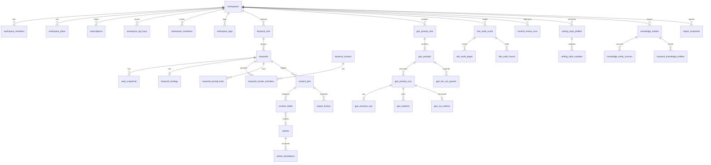

# 데이터 모델 (역공학 확정본)

> 근거: E5-1 `p5-table-columns.json`(정적 `.from().select/eq/order/insert` × 런타임 응답 키), E5-2 `p5-bundled-erd-edges.json`(번들 동봉 내부 ERD v1.1, 2026-02-23 — 구버전 가능), E3-1 런타임 shape.
> 표기: **[관찰]** 코드/응답에 문자 그대로 존재 · **[추론]** 조합 추론 · **[미확인]** 증거 없음.

비유하자면 원본 DB는 "워크스페이스라는 서랍장" 하나에 키워드·질문·진단·콘텐츠 서랍이 달린 구조입니다. 모든 업무 테이블이 `workspace_id`로 서랍장에 매달려 있고, 접근 통제(RLS)는 이 열쇠 하나로 이뤄집니다.

## 1. 규모와 공통 규약 [관찰]

- 앱 코드가 참조하는 테이블 **164개**, RPC **139개**, Edge Function **131개** (정적, 1,094 청크 전수). 내부 문서 자체 집계는 "120+ 테이블".
- PK는 `id uuid`, 시간 컬럼은 `created_at`/`updated_at`(timestamptz) — 런타임 shape에서 `string<uuid>`, `string<datetime>`으로 일관 관찰.
- 소프트 삭제: `deleted_at`(keywords, geo_prompts) + `is_active` 플래그 병행. 일시정지: `is_paused`(keywords, geo_prompts).
- 워크스페이스 미러링: `mirror_of_id`(keywords, keyword_sets, geo_prompt_sets, geo_prompts, workspace_tags) + `workspace_mirrors` [관찰] → 데모/템플릿 워크스페이스 복제 기능으로 [추론].
- JSON 컬럼 다수(`*_json`, `settings`, `stats_json`, `*_payload`): 외부 API 원문과 집계 캐시를 JSONB로 보관 [관찰].

## 2. 핵심 ERD

교차 검증(스크립트 검증): 내부 ERD 22개 엣지 중 **20개**가 정적 임베드 관계(`select("*,rel(...)")`) 또는 자식 테이블 FK 컬럼(`*_id`)으로 재확인됨. 미재확인 2개: `content_review_runs → content_change_items`, `knowledge_entities → evidence_claims` — 양쪽 테이블 모두 코드에서 참조되지만 클라이언트가 해당 FK 컬럼을 읽지 않아 관계 자체는 [미확인](ERD 문서만의 단일 근거).

## 3. 엔티티 정의 (Tasks.md 13개 엔티티 매핑)

| 엔티티 | 원본 테이블 | 핵심 컬럼 [관찰] | 상태 |
|---|---|---|---|
| Workspace | `workspaces` | id, name, slug, owner_id, status, settings(JSON), auto_generate_prompts, default_brand_filter, sitemap_url, robots_txt_url, llms_txt_url, site_audit_scope_rules, strategy_map_status, strategy_map_scanned_at, product_lineup_hints, schema_classification_policy | 답변됨 |
| Member | `workspace_members`, `workspace_invitations`, `profiles` | members: workspace_id, user_id, role, joined_at · invitations: email, role, status, expires_at, allowed_sections · profiles: full_name, phone_number | 답변됨 (역할 enum 값은 [미확인]) |
| Brand | `keyword_sets`(brand_name, target_domain, competitor_domains, industry, language, country, journey_stage, is_default), `workspace_brand_domains`(self_roots) | 브랜드/경쟁사 정의가 **키워드 세트 단위**로 저장됨 [관찰] | 부분 답변 — 별도 brands 테이블 없음 |
| Keyword | `keywords` | keyword, keyword_set_id, language, country, search_volume, search_volume_google_ads, keyword_difficulty, competition, cpc_min/max, intent, intent_probability, trends_json, status, origin_type, geo_cluster_id, geo_prompt_id, source_prompt_id, is_active, is_paused, deleted_at | 답변됨 |
| SERP 스냅샷 | `serp_snapshots` | keyword_id, engine(google/naver), captured_at, ai_overview_detected, ai_overview_json, top_results_json, paa_questions_json, related_searches_json, featured_snippet_json, serp_analysis_json, gap_summary | 답변됨 |
| Prompt | `geo_prompt_sets`, `geo_prompts`, `geo_prompt_candidates` | sets: name, default_engine, schedule_enabled, schedule_hour, is_active · prompts: prompt_text, prompt_category, language_code, location_code, search_volume, cm_brand/cm_industry/cm_question_type · candidates: prompt_text, intent_subtype, funnel_stage, opportunity_score, status | 답변됨 |
| Run (수집 원본) | `geo_prompt_runs`, `geo_answers_raw`, `geo_citations`, `geo_run_metrics`, `geo_sources`, `geo_fan_out_queries` | runs: prompt_id, engine, model_name, mode, status, requested_at, finished_at, cost_usd · raw: answer_text, web_sources, tokens_used · citations: cited_url, domain, root_domain, position_index, is_ours, is_competitor, domain_classification · metrics: brand_mentioned, is_cited, citation_rate, our/competitor/other_citation_count, source_but_not_cited | 답변됨 |
| Report | `report_snapshots` (+`report_summaries`, `report_action_items`) | period_type(week/month), period_key, start_date, end_date, kpi_payload, changes_payload, actions_payload, prompt_set_id | 답변됨 (payload 내부 구조 [미확인]) |
| Persona | `writing_style_profiles`, `writing_style_samples` | profiles: name, description, is_default · samples: content, source_type, source_url, word_count | 답변됨 |
| Content | `content_jobs`, `content_drafts`, `content_compositions`, `articles`, `article_translations`, `content_review_runs`(최적화) | jobs: keyword_id, geo_prompt_id, stage, strategy_status, writing_status, target_keyword, writing_style_profile_id, knowledge_entity_ids · drafts: version, title, content_md, meta_*, seo_score, aio_score, word_count, quality_analysis, grounding_sources, is_selected | 답변됨 |
| SiteAudit | `site_audit_scans`, `site_audit_pages`, `site_audit_issues`, `site_audit_links`, `site_audit_scores` | scans: target_url, scan_type, scan_mode, status, max_pages, crawled_urls, site_health_score(_v2), ai_readiness_score(_v2), critical/warning/notice_count · issues: issue_type, category, severity, layer, score_dimension, fix_recommendation, fix_difficulty, impact_level, is_resolved | 답변됨 |
| Export | `export_history` | content_job_id, exported_at, workspace_id (형식·대상 컬럼 [미확인]) | 부분 답변 |
| Notification | `geo_alerts`, `serp_decision_alert_log`, `workspace_events`(event_type, metadata), `feedback_reply_notifications` | 알림 설정값 저장 위치 [미확인] — `workspaces.settings` JSON 내부일 가능성 [추론] | 부분 답변 |
| ApiKey | `workspace_api_keys` | name, key_prefix, scopes, expires_at, last_used_at, revoked_at (해시 컬럼은 클라이언트에 노출 안 됨) · RPC: revoke_workspace_api_key, update_workspace_api_key_limits, get_api_key_usage_stats | 답변됨 |

### 보조 도메인 [관찰]

- 과금·쿼터: `workspace_plans`(plan, billing_cycle, trial_ends_at, expires_at), `plan_templates`, `plan_unit_limits`(plan_key, unit_key, monthly_limit), `usage_reservations`(unit_key, amount, idempotency_key, status), `workspace_usage`; RPC `reserve_unit_with_bypass → commit_reservation | release_reservation` (예약-확정 2단계 차감), `get_workspace_quota_summary`(unit별 plan_limit/used/remaining/credit_balance/effective_limit). 결제: `subscriptions`, `orders` + NicePay Edge Functions.
- 검색 성과 연동: `workspace_google_connections`, `gsc_daily_totals/pages/keywords`, `ga4_page_stats`(ai_sessions_chatgpt/claude/gemini/perplexity), `gsc_sync_state`.
- 전략맵: `keyword_clusters`(label, stats_json[geo.neighbors 등]), `keyword_cluster_members`(similarity_score, pillar_score), `cluster_stats_history`, `keyword_prompt_links`.
- 지식 허브: `knowledge_entities`(knowledge_type, program_type, coverage_type), `knowledge_entity_sources`, `knowledge_claim_stats`(verified/unverified/conflicted/stale claims), `evidence_contexts`.
- 에이전트: `agent_conversations`, `agent_messages`.
- 태그: `workspace_tag_groups`, `workspace_tags`, `keyword_tag_assignments`, `geo_prompt_tag_assignments`.

## 4. 클론 스키마 제안 [추론 · Phase 7 입력]

클론은 원본 164개 테이블을 그대로 복제하지 않고 **13개 핵심 엔티티 + 보조 6개**로 압축한다. 집계 캐시(`*_stats_history`, `knowledge_claim_stats` 등)는 뷰 또는 RPC로 대체한다.

| 클론 테이블 | 원본 대응 | 비고 |
|---|---|---|
| workspaces, workspace_members, workspace_invitations | 동일 | RLS: `workspace_id in (select workspace_id from workspace_members where user_id = auth.uid())` |
| brands (신규) | keyword_sets.brand_name/target_domain/competitor_domains | 브랜드·경쟁사 도메인을 1급 엔티티로 분리 |
| keyword_sets, keywords, serp_snapshots | 동일 | SERP JSON은 `top_results`, `ai_overview`, `paa` 3개 JSONB로 축소 |
| prompt_sets, prompts, prompt_runs, run_citations, run_metrics | geo_* | `run_metrics`는 run 완료 시 트리거로 계산 |
| site_audits, site_audit_pages, site_audit_issues | site_audit_* | v1/v2 점수 이원화 제거 |
| content_jobs, content_drafts, export_history | 동일 | articles/translations는 Phase 7 범위 밖 |
| personas, knowledge_entities, knowledge_sources | writing_style_profiles, knowledge_* | |
| report_snapshots, notifications (신규), api_keys | 동일/분리 | notifications는 명시 테이블로 신설 |
| plans, usage_ledger | workspace_plans, usage_reservations | 예약-확정 차감 패턴 유지 |

## 5. 미해결 [미확인]

RLS 정책 본문, DB 트리거·cron, enum 값 전체(role, status, stage 등), JSONB 내부 스키마(kpi_payload, stats_json 등), 서버 측 집계 RPC의 SQL 본문은 클라이언트 증거로 도달할 수 없다. 클론에서는 관찰된 출력 shape(`api-spec.md`)를 계약으로 삼아 재설계한다.
