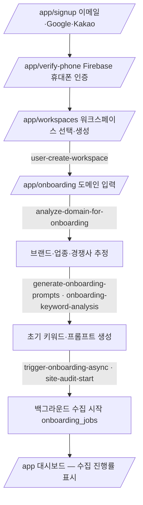
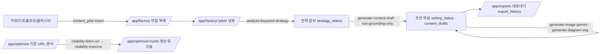

# 핵심 사용자 여정

> 근거: 라우트 트리(E1-1), 페이지별 Edge Function 의존성(E1-4), 런타임 호출(E3-1), 공개 문서 기능 흐름(SUP `docs.haloxlabs.ai/ko/features/*`), 기존 스크레이프(SUP `docs/sources`).
> 표기: 각 단계 끝의 `[관찰]`/`[추론]`/`[미확인]`은 그 단계가 어떤 증거로 확인됐는지를 뜻한다. 액션(생성·실행) 단계의 서버 응답 shape는 읽기 전용 캡처 범위 밖이라 대부분 `[관찰-정적]`이다.

비유: HaloX 여정은 "건강검진 → 진단서 → 처방 → 복약 → 재검진" 순환입니다. 키워드·질문을 등록(검진 항목)하고, 분석(진단서)으로 약점을 찾고, 전략맵·진단(처방)으로 우선순위를 정하고, 콘텐츠 제작(복약)을 한 뒤 모니터링·리포트(재검진)로 효과를 봅니다.

## J0. 가입 → 워크스페이스 → 온보딩

- 라우트·함수 존재: [관찰]. 각 단계의 입력 필드와 화면 순서: [추론] (온보딩 화면 스크레이프 없음 — 기존 계정은 온보딩 완료 상태).

## J1. 키워드 등록 → SEO 분석

1. `/app/keywords` → 키워드 추가 다이얼로그(`KeywordAddDialog`) → 쿼터 예약 `reserve_unit_with_bypass({_unit_key:"keyword_create", _amount:1, _idempotency_key})` → 실패 시 `error_code==="QUOTA_EXCEEDED"`면 한도 초과 안내 → 성공 시 `keywords` insert → `commit_reservation` [관찰-정적].
2. 수집: `bulk-collect-keyword-data` / `dataforseo-search-volume|keyword-difficulty|search-intent` / `fetch-serp-snapshot` / `naver-serp-scheduler` [관찰-정적] → 목록이 `serp_snapshots`·`keywords.*` 갱신을 폴링으로 반영 [관찰 · `get_latest_serp_snapshots`, HEAD `keyword_serp_jobs`].
3. `/app/keywords/:keywordId` 상세(상위 결과, PAA, 전략) → `analyze-keyword-strategy` [관찰-정적].
4. `/app/seo/insights` 개요·성과·경쟁사·기회·AIO·SERP 매트릭스 탭 [관찰 · 스크레이프 + `get_seo_overview_agg`, `get_seo_rank_movers`, `get_serp_brand_presence_trend`].

## J2. 프롬프트(질문) → GEO 실행 → 분석

1. `/app/geo/prompts` 세트·프롬프트 생성(`GeoSetCreateDialog`, `GeoPromptCreateDialog`) [관찰-정적] 또는 `/app/discover` 질문 발굴(`geo-discover-run` → `geo_prompt_candidates` 승인) [관찰-정적].
2. 실행: `geo-run-prompts-fanout` → 엔진별 실행 → `geo_prompt_runs`/`geo_citations`/`geo_run_metrics` [관찰-정적 + SUP 카탈로그]. 세트 단위 스케줄(`schedule_enabled`, `schedule_hour`) [관찰].
3. `/app/geo/analysis` 9개 탭으로 분석 [관찰 · 스크레이프 9종 + 런타임 `get_geo_group_status_kpi_multi`]. 멘션 용어(`get_geo_ws_mention_terms`)는 설정의 브랜드 트래킹 탭, 슬롯 수(`get_geo_slot_counts`)는 대시보드·워크스페이스 화면에서 관찰.

## J3. 갭 → 전략맵 → 사이트 진단

1. `/app/gap` SEO×GEO 교차(개요/매트릭스/키워드/프롬프트/경쟁사/콘텐츠/트렌드) [관찰 · 스크레이프 7종 + `get_gap_overview_light`].
2. `/app/strategy-map` `strategy-map-orchestrator` → 클러스터 리스트/포트폴리오/네트워크 [관찰 · `strategy_map_effective_state`, `keyword_clusters`].
3. `/app/site-audit` `site-audit-start` → 크롤 진행 → 개요·AI 봇 접근성·이슈·페이지·엔티티·내부 링크·가이드 [관찰 · `site_audit_scans/pages/issues`, `site_audit_links_summary`]. 비교: `/app/site-audit/diff` [관찰-정적].

## J4. 콘텐츠 제작 → 최적화 → 내보내기

- 함수 연결: [관찰-정적]. 작업 상태값 `running/strategy/writing/completed/failed/pending/review` 문자열 [관찰-정적, FactoryPage·FactoryDetailPage]. 페르소나(`writing_style_profiles`)와 지식 엔티티(`knowledge_entity_ids`)를 작업에 연결 [관찰].

## J5. 모니터링 → 리포트

1. `/app/settings?tab=integrations` Google 연결(`google-oauth-init` → `gsc-list-properties`/`ga4-list-properties` → `gsc-sync-enqueue`/`sync-ga4-data`) [관찰-정적].
2. `/app/monitoring` overview/queries/pages [관찰 · 런타임 `get_gsc_dashboard_kpis|timeseries|dimensions`, `get_ga4_channel_summary|dashboard_timeseries`]. 원천 테이블 `gsc_daily_*`·`ga4_page_stats` 직접 조회는 연동 설정 탭·대시보드·SEO 인사이트에서 관찰.
3. `/app/reports/weekly` · `/monthly` → `generate-weekly-snapshot` → `report_snapshots` (+ `generate-report-summary`) [관찰].

## J6. 설정 (12 탭)

워크스페이스·멤버(초대 `workspace-invite`, `update_workspace_member`, `transfer_workspace_ownership`)·일반·사용량(`get_workspace_quota_summary`)·구독/결제(NicePay)·연동·브랜드 트래킹·태그·등록 URL(`earned_publications`)·내보내기·알림·API&MCP(`workspace_api_keys`, `revoke_workspace_api_key`) [관찰 · 스크레이프 12종 + E3-1 런타임].

## 여정 커버리지 요약

| 여정 | 라우트 | 읽기 데이터 계약 | 쓰기/액션 계약 | 판정 |
|---|---|---|---|---|
| J0 가입·온보딩 | 관찰 | 부분 | 정적만 | 부분 답변 |
| J1 키워드·SEO | 관찰 | 관찰 | 정적만 | 부분 답변 |
| J2 GEO | 관찰 | 관찰 | 정적만 | 부분 답변 |
| J3 갭·전략·진단 | 관찰 | 관찰 | 정적만 | 부분 답변 |
| J4 콘텐츠 | 관찰 | 관찰(목록) | 정적만 | 부분 답변 |
| J5 모니터링·리포트 | 관찰 | 관찰 | 정적만 | 부분 답변 |
| J6 설정 | 관찰 | 관찰 | 정적만 | 부분 답변 |

쓰기 계약을 "답변됨"으로 올리려면 생성·실행 액션을 포함한 HAR이 필요하다(쿼터 소모 발생 → 사용자 승인 필요). 클론에서는 정적 증거 + 관찰된 결과 테이블 shape로 계약을 재정의해도 구현 가능하다.
